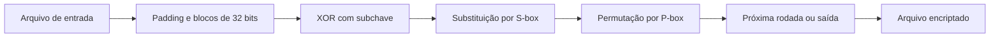

# Cifra_bloco · Estudo de criptografia em Python

[← Voltar ao portfólio](../README.md)

## Problema

Explorar como uma cifra simétrica transforma os bytes de um arquivo em blocos e como as operações podem ser invertidas para recuperar o conteúdo original com a mesma chave.

## Solução desenvolvida

Implementação didática em Python que encripta e decripta arquivos em **blocos de 32 bits**, equivalentes a quatro bytes. O processamento usa **oito rodadas por padrão**, com quantidade configurável e mínimo de três.

Cada rodada mistura o bloco com uma subchave por **XOR**, substitui grupos de quatro bits usando uma **S-box** e reorganiza os bits usando uma **P-box**. As tabelas de substituição e permutação dependem da subchave da rodada. A decriptação percorre as operações inversas em ordem reversa.

O preenchimento, ou padding, permite completar o último bloco. Na decriptação, esse preenchimento é verificado e removido. O código deriva as subchaves a partir de uma chave textual e utiliza apenas a biblioteca padrão do Python.

## Cenário ilustrativo

1. Escolher um arquivo de exemplo e uma chave textual fictícia.
2. Encriptar o arquivo com a quantidade de rodadas escolhida.
3. Decriptar a saída usando a mesma chave e quantidade de rodadas.
4. Comparar o conteúdo recuperado com o arquivo de entrada.

Esse roteiro explica o uso previsto; não constitui um resultado de teste publicado.

## Linha de comando

A CLI recebe a operação `encrypt` ou `decrypt`, os caminhos dos arquivos de entrada e saída, a chave com `--key` e, opcionalmente, o número de rodadas com `--rounds`. Também aceita os atalhos `enc` e `dec`. Ao iniciar sem parâmetros, oferece um modo interativo para informar esses dados.

## Tecnologias

Python, operações de bits, XOR, S-box, P-box e `argparse`.

## Estado atual

Estudo didático de cifra de blocos para compreender substituição, permutação, subchaves e reversibilidade. A apresentação não atribui certificação de segurança ao algoritmo nem publica resultados de validação criptográfica.

O código integral fica no [repositório privado Cifra_bloco](https://github.com/contatodevjoaocarvalho-web/Cifra_bloco), cujo acesso depende de autorização. Este repositório público contém somente a apresentação e o diagrama conceitual do projeto.
