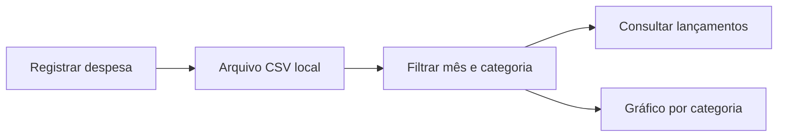

# Dinheirômetro · Controle de despesas

[← Voltar ao portfólio](../README.md)

## Problema

Registrar gastos em locais diferentes dificulta acompanhar quanto foi gasto no mês e quais categorias concentram as despesas.

## Solução desenvolvida

Aplicação desktop para cadastrar, editar e excluir despesas, gerenciar categorias, filtrar lançamentos por mês e categoria e visualizar totais em gráficos de barras. O projeto utiliza armazenamento local em CSV.

## Demonstração com dados fictícios

| Data | Categoria | Descrição | Valor |
| --- | --- | --- | ---: |
| 03/10/2026 | Alimentação | Compra de exemplo | R$ 120,00 |
| 05/10/2026 | Transporte | Deslocamento de exemplo | R$ 40,00 |
| 08/10/2026 | Alimentação | Refeição de exemplo | R$ 30,00 |

Nesse exemplo, o total é **R$ 190,00**: alimentação soma **R$ 150,00** e transporte soma **R$ 40,00**. Ao filtrar alimentação, a consulta considera apenas os dois lançamentos dessa categoria.

Este cálculo ilustra o comportamento proposto; não é uma captura ou resultado de execução da aplicação.

## Tecnologias

Python, ttkbootstrap para a interface, pandas para manipulação dos dados e matplotlib para gráficos.

## Estado atual

Projeto desktop existente. A execução da versão arquivada ainda precisa ser validada em um ambiente limpo. Os arquivos financeiros pessoais não fazem parte desta demonstração.
