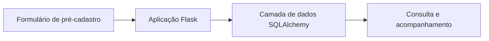

# Optimus RH · Fluxo de pré-cadastro

[← Voltar ao portfólio](../README.md)

## Problema

Organizar informações de pré-cadastro e acompanhar etapas de um processo em uma aplicação web.

## Solução em protótipo

Formulários de pré-cadastro e acompanhamento de processos, com uma camada web em Flask e acesso a dados com SQLAlchemy. O projeto também contém um estudo de automação com Playwright.

## Cenário ilustrativo

Uma pessoa fictícia preenche informações de exemplo no pré-cadastro. A aplicação organiza o registro para consulta e acompanhamento do processo. Nenhum dado real de candidato é utilizado neste portfólio.

## Estudo de automação

O estudo de RPA usa **Sauce Demo**, um ambiente demonstrativo. Ele não comprova integração com sistemas reais de folha de pagamento ou benefícios e não representa uma operação de RH em produção.

## Tecnologias

Python, Flask, SQLAlchemy e Playwright.

## Estado atual

Protótipo e estudo de automação. A execução integrada ainda precisa ser validada. Bancos locais, documentos e dados de candidatos permanecem fora do material público.
