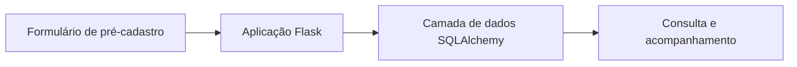
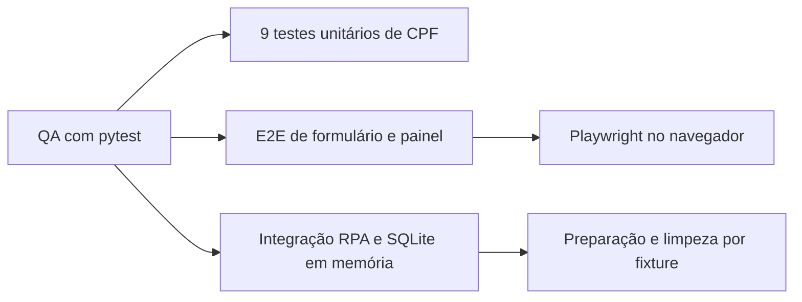

# Optimus RH · Fluxo de pré-cadastro e QA

[← Voltar ao portfólio](../README.md)

## Problema

Organizar informações de pré-cadastro e acompanhar etapas de um processo em uma aplicação web.

## Solução em protótipo

Formulários de pré-cadastro e acompanhamento de processos, com uma camada web em Flask e acesso a dados com SQLAlchemy. O projeto também contém um estudo de automação com Playwright.

## Cenário ilustrativo

Uma pessoa fictícia preenche informações de exemplo no pré-cadastro. A aplicação organiza o registro para consulta e acompanhamento do processo. Nenhum dado real de candidato é utilizado neste portfólio.

## Estudo de automação

O estudo de RPA usa **Sauce Demo**, um ambiente demonstrativo. Ele não comprova integração com sistemas reais de folha de pagamento ou benefícios e não representa uma operação de RH em produção.

## Estrutura de testes de QA

O código contém **11 casos de teste** distribuídos em três frentes, com pytest e Playwright:

| Frente | Estrutura presente no código | Verificação prevista |
| --- | --- | --- |
| Unitários · 9 casos | `teste/test_unico.py` | Formato e limpeza de CPF com e sem pontuação, tamanho curto ou longo, dígitos iguais, entrada vazia, letras, espaços e `None`. |
| E2E · 1 caso | `teste/test_e2e_site.py` | Abrir o pré-cadastro pelo navegador, preencher o formulário e conferir o candidato e o status **Aguardando Preenchimento** no painel. |
| Integração da RPA · 1 caso | `teste/test_automacao_completa.py` | Criar um candidato com status **Aguardando Robô**, chamar o processamento e verificar o retorno e a mudança para **Processado com Sucesso**. |

O teste E2E usa Playwright com uma aplicação Flask servida durante o teste. O teste de integração prepara tabelas em **SQLite em memória** por meio de uma fixture do pytest e remove as tabelas após o uso. A estrutura segue a sequência preparar o cenário, executar a ação e verificar o resultado.

Esses itens descrevem testes encontrados no código. Esta apresentação não informa aprovação da suíte, relatório de execução ou percentual de cobertura. Os testes de CPF abordam **formato e limpeza**, sem comprovar a validade dos dígitos verificadores.

## Tecnologias

Python, Flask, SQLAlchemy, Playwright, pytest e SQLite.

## Estado atual

Protótipo com estudo de automação e casos de teste implementados. A execução integrada ainda precisa ser validada. Bancos locais, documentos e dados de candidatos permanecem fora do material público.

O código integral e os arquivos de teste estão no [repositório privado Optimus RH](https://github.com/contatodevjoaocarvalho-web/optimus-rh), cujo acesso depende de autorização. Este repositório público contém a apresentação do projeto.
