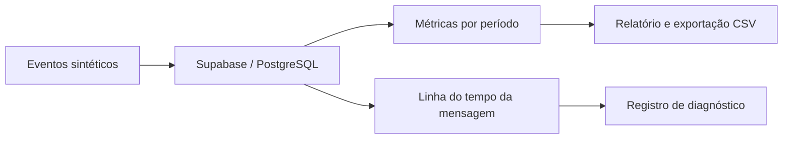

# SESlock Holmes · Observabilidade de e-mails

[← Voltar ao portfólio](../README.md)

## Problema

Entender o que aconteceu com uma mensagem de e-mail exige relacionar eventos, destinatários e indicadores de entrega. Este TCC organiza essas informações para apoiar investigação e registro de diagnósticos.

## Solução desenvolvida

Consulta de métricas por período, busca e linha do tempo de mensagens, relatórios comparativos, exportação CSV, controle de acesso e registro de diagnósticos e correções.

## Exemplo de investigação

Cenário fictício de avaliação local, sem envio real de e-mails:

| Indicador | Cenário sintético |
| --- | --- |
| Destinatários | 5 |
| Entregas | 3 |
| Rejeição permanente | 1 |
| Reclamação | 1 |
| Pendência | 1 |

Os indicadores representam eventos do cenário e não precisam ser categorias exclusivas. O usuário consulta o período, abre uma mensagem, acompanha seus eventos e registra uma hipótese com evidências. O registro de uma correção documenta uma ação; não executa mudanças automaticamente.

## Tecnologias e práticas

TypeScript, Supabase Auth, PostgreSQL, funções e regras de autorização, testes automatizados e GitHub Actions para validação e relatórios sintéticos.

## Estado atual

Recursos de consulta, investigação e relatórios disponíveis no ambiente local. A integração real com Amazon SES e a coleta acadêmica de avaliação continuam pendentes. Os dados deste exemplo não representam desempenho real de entrega.
