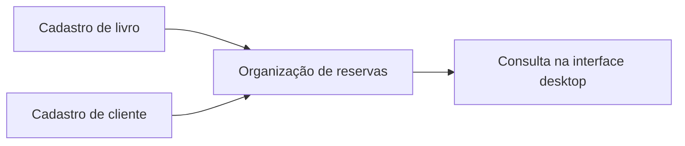

# Sistema Biblioteca · Livros, clientes e reservas

[← Voltar ao portfólio](../README.md)

## Problema

Organizar livros, clientes e reservas em uma interface desktop para um cenário acadêmico de biblioteca.

## Solução desenvolvida

Aplicação Java Swing com telas de cadastro e consulta para livros, clientes e reservas, organizada como projeto do NetBeans.

## Cenário ilustrativo

1. Cadastrar o livro fictício **Introdução à Programação**, código **LIV-001**.
2. Cadastrar o cliente fictício **Pessoa Exemplo**, código **CLI-001**.
3. Utilizar o fluxo de reservas para relacionar cliente e livro.
4. Consultar os registros nas telas do sistema.

O roteiro apresenta a finalidade das telas, sem representar um teste executado nesta publicação.

## Tecnologias

Java, Swing e NetBeans. O projeto acadêmico utiliza listas em memória.

## Estado atual

Código acadêmico preservado. A execução ainda não foi validada nesta preparação. A persistência após fechar a aplicação não é um recurso demonstrado nesta versão.
